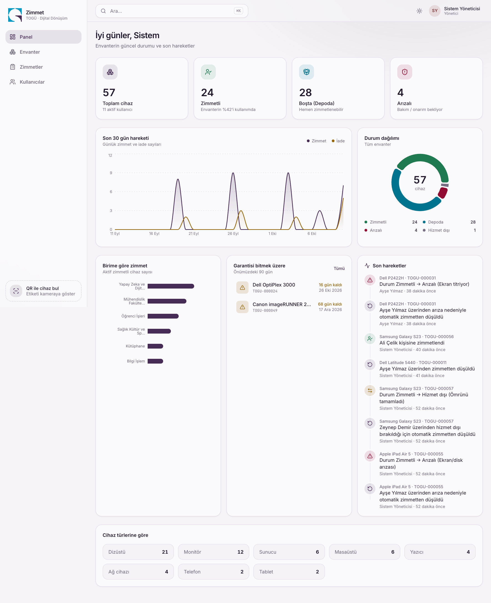
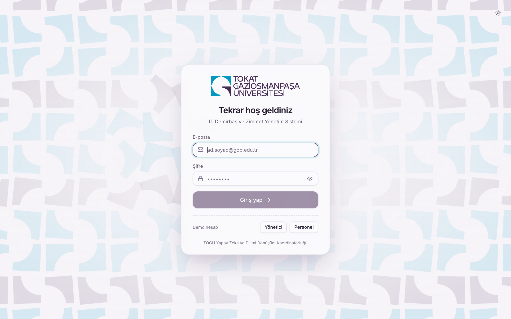
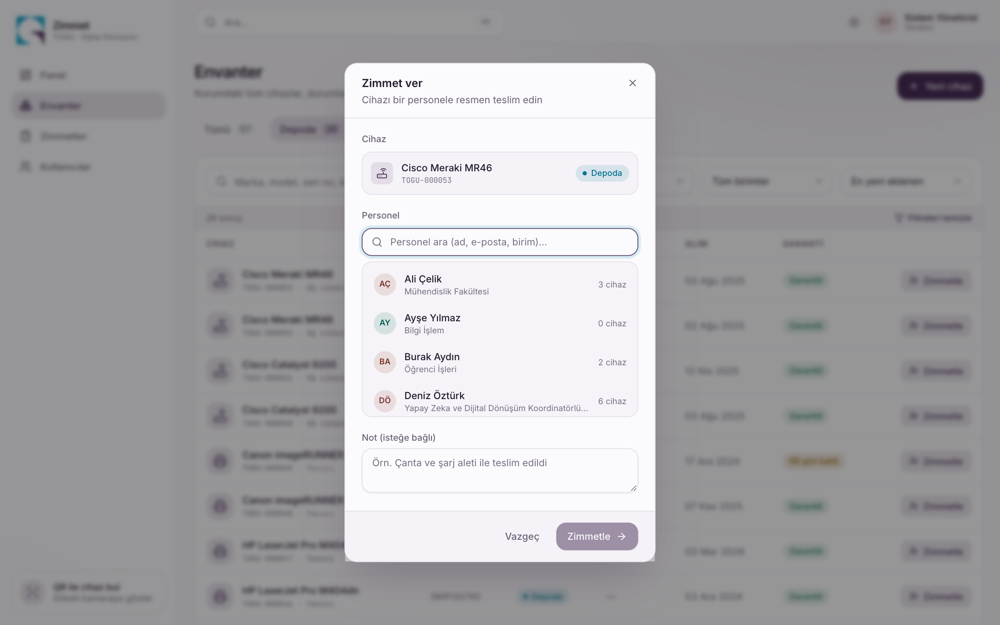
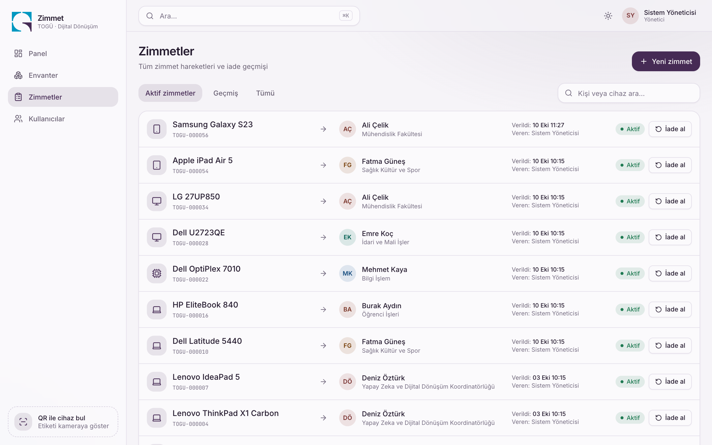
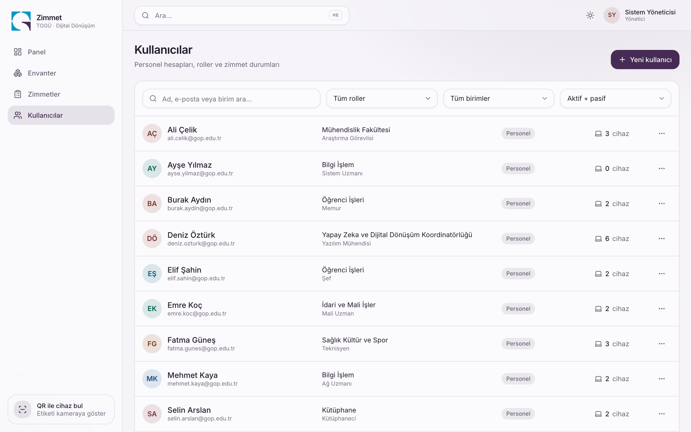
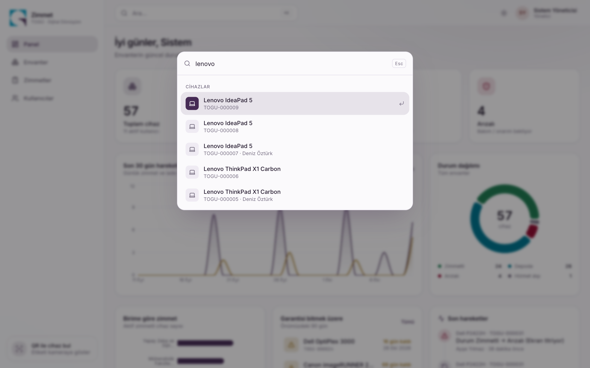
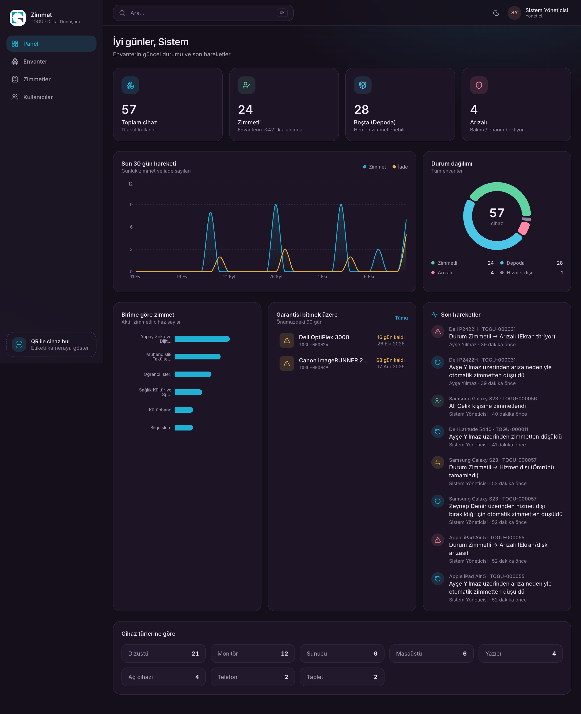
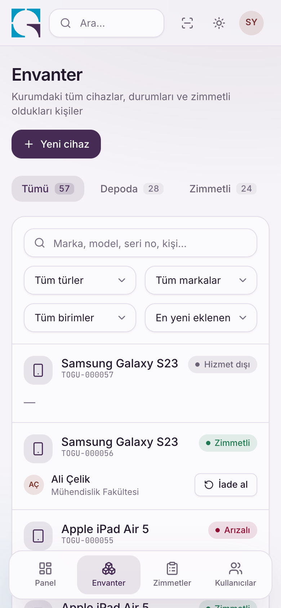
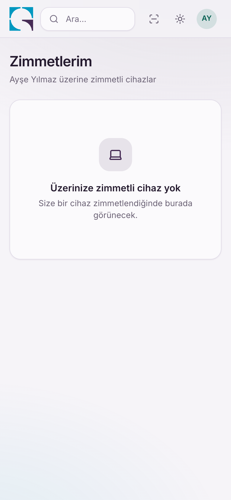

# Zimmet · IT Demirbaş ve Zimmet Yönetim Sistemi

TOGÜ Yapay Zeka ve Dijital Dönüşüm Koordinatörlüğü **Aday Mühendis Değerlendirme Projesi**.

Kurumdaki bilgisayar, sunucu, monitör gibi donanımların envantere kaydedildiği, durumlarının takip edildiği ve personele **zimmetlendiği** full-stack bir web uygulaması. Her cihaza otomatik benzersiz bir **QR kod** üretilir; zimmet, iade ve arıza süreçleri **otomatik tutarlılık kurallarıyla** yönetilir.

| | |
|---|---|
| **Backend** | Node.js · Fastify 5 · TypeScript · Prisma 6 · PostgreSQL 16 · JWT · Zod |
| **Frontend** | React 19 · Vite · TypeScript · Tailwind CSS 4 · TanStack Query · Framer Motion · Recharts |
| **Altyapı** | Docker · docker-compose · nginx |
| **Test** | Vitest (backend entegrasyon + frontend bileşen) |



## Hızlı başlangıç (tek komut)

Gereksinim: Docker ve Docker Compose.

```bash
git clone <repo-url> && cd <repo>
docker compose up --build
```

İlk açılışta veritabanı migration'ları uygulanır, yönetici hesabı ve örnek veriler oluşturulur.

| Adres | Açıklama |
|---|---|
| http://localhost:8080 | Uygulama |
| http://localhost:8080/docs | Swagger / OpenAPI dokümantasyonu |

**Demo hesaplar** (giriş ekranındaki butonlarla da doldurulabilir)

| Rol | E-posta | Şifre |
|---|---|---|
| Yönetici | `admin@gop.edu.tr` | `Admin123!` |
| Personel | `ayse.yilmaz@gop.edu.tr` | `Demo1234` |

> Temiz bir başlangıç için: `docker compose down -v && docker compose up --build`

## Ortam değişkenleri

Docker için kök dizindeki `.env.example` dosyasını `.env` olarak kopyalayıp düzenleyebilirsiniz. **Hiçbiri zorunlu değildir**, varsayılanlar çalışır.

| Değişken | Varsayılan | Açıklama |
|---|---|---|
| `POSTGRES_USER` / `POSTGRES_PASSWORD` / `POSTGRES_DB` | `zimmet` … | Veritabanı bilgileri |
| `JWT_SECRET` | örnek değer | **Üretimde değiştirin**, en az 32 karakter |
| `JWT_EXPIRES_IN` | `8h` | Oturum süresi |
| `ADMIN_EMAIL` / `ADMIN_PASSWORD` | `admin@gop.edu.tr` / `Admin123!` | İlk yönetici hesabı |
| `SEED_DEMO` | `true` | İlk açılışta örnek kullanıcı ve cihaz yükle |
| `VITE_DEMO_LOGIN` | `true` | Giriş ekranında demo hesap butonlarını göster |
| `WEB_PORT` / `API_PORT` / `DB_PORT` | `8080` / `3000` / `5440` | Yayınlanan portlar |
| `APP_URL` | `http://localhost:8080` | **QR kodların işaret ettiği adres.** Telefonla okutulunca açılacak site; yayında gerçek alan adınız olmalı |
| `CORS_ORIGIN` | `http://localhost:8080` | İzin verilen web adresi (virgülle birden çok) |

Yerel geliştirme için backend ayarları `backend/.env` içindedir (`backend/.env.example` şablon).

## Yerel geliştirme

```bash
docker compose up -d db                    # yalnızca PostgreSQL (localhost:5440)

cd backend
npm install
cp .env.example .env
npx prisma migrate deploy
npm run seed -- --demo                     # yönetici + örnek veri
npm run dev                                # http://localhost:3000

cd ../frontend                             # ayrı bir terminalde
npm install
npm run dev                                # http://localhost:5173  (/api → 3000'e yönlenir)
```

## Testler

```bash
docker compose up -d db
cd backend  && npm test        # 43 entegrasyon testi (ayrı zimmet_test veritabanı kullanır)
cd frontend && npm test        # 26 test
```

Backend testleri gerçek PostgreSQL üzerinde çalışır; ayrıca şunları doğrular: yetkilendirme (RBAC), doğrulama, sayfalama/arama/filtre, **otomatik zimmet düşme senaryolarının tamamı**, **eşzamanlı zimmet yarışı** ve veritabanı seviyesindeki kısıtlar.

## Özellikler

### Zorunlu isterler
- **Kimlik doğrulama:** JWT ile giriş/çıkış. Şifre değişince veya kullanıcı pasife alınınca eski token'lar geçersiz olur. Girişte hız sınırı vardır.
- **Rol yönetimi:** Yönetici ve Standart Personel. Yönetici; kullanıcı ekler, düzenler, siler, şifre sıfırlar (son aktif yönetici korunur).
- **Dashboard:** Toplam / zimmetli / boşta / arızalı cihaz, 30 günlük hareket grafiği, birim dağılımı, garantisi bitmek üzere olanlar, son hareketler.
- **Envanter:** Cihaz ekle/sil/güncelle (marka, model, seri no, alım tarihi, garanti, konum, not). Otomatik **demirbaş no** (`TOGU-000001`) ve **QR kod** (PNG indir / yazdırılabilir etiket).
- **Zimmet:** Atama, zimmetten düşme, devretme. Tüm geçmiş `Assignment` kayıtlarında ve denetim izinde (aktivite kaydı) tutulur.
- **Filtreleme:** Durum, tür, marka, birim/kişi ve serbest arama; sayfalama; filtreler URL'de saklanır (paylaşılabilir).
- **Arayüz:** Mobil uyumlu, anlık bildirim (toast), açık/koyu/sistem teması.

### Otomatik tutarlılık kuralları
Bu kuralların hepsi **tek bir veritabanı transaction'ında** ve cihaz satırı kilitlenerek çalışır:

| Olay | Sonuç |
|---|---|
| Zimmetli cihaz **Arızalı** yapılır / personel **arıza bildirir** | Zimmet **otomatik düşer**, cihaz Arızalı olur |
| Zimmetli cihaz **Hizmet dışı** yapılır | Zimmet otomatik düşer |
| **İade al** (sağlam) | Zimmet kapanır, cihaz **Depoda** |
| **İade al** (arızalı) | Zimmet kapanır, cihaz **Arızalı** |
| Cihaz başkasındayken yeni kişiye zimmetlenir | Önceki zimmet otomatik düşer (**devir**) |
| Kullanıcı **pasife alınır / silinir** | Üzerindeki tüm cihazlar otomatik **Depoya** döner |
| Zimmet geçmişi olan kullanıcı silinir | Denetim izi korunur: kayıt silinmez, pasife alınır |
| Arızalı / hizmet dışı cihaza zimmet | Reddedilir |
| Aynı cihaza eşzamanlı iki zimmet isteği | Yalnızca biri başarılı olur |

**Veritabanı güvencesi:** `Assignment` tablosunda *"bir cihazın aynı anda yalnızca bir aktif zimmeti olabilir"* kuralı kısmi unique index ile (`WHERE "returnedAt" IS NULL`) uygulama kodundan bağımsız olarak garanti edilir.

### Ek özellikler
- **⌘K / Ctrl+K komut paleti:** cihaz, kişi veya sayfaya anında git.
- **QR tarama (web):** kameradan cihaz etiketini okut; QR bağlantısı (`/scan/:token`) telefonun kamerasıyla da çalışır.
- **Personel ekranı:** kişisel zimmet listesi ve **Arıza bildir** (zimmet otomatik düşer).
- Garanti bitiş uyarıları, yazdırılabilir QR etiketi, Swagger dokümantasyonu.

## Ekran görüntüleri

| | |
|---|---|
|  |  |
|  |  |
|  |  |
|  |  |

<p>
  
  
</p>

## Kurumsal kimlik ve tasarım

Arayüz, **Tokat Gaziosmanpaşa Üniversitesi Kurumsal Kimlik Kılavuzu**na göre tasarlanmıştır.

- **Renkler:** Kılavuzdaki resmî logo renkleri (Gökmedrese'nin firuze ve mor çinileri): mor `#462B55`, firuze `#0098C0`, bordo `#910C32`. Resmî firuze açık zeminde metin için yetersiz kontrasta sahip (3.2:1) olduğundan **birincil renk mor**, firuze ise vurgu ve odak halkası olarak kullanılır; bağlantı/bilgi metinleri için koyulaştırılmış tonu (`#00748F`, 5.2:1) kullanılır.
- **Logo:** Resmî vektör logo, kılavuz kurallarına uygun kullanılır: renk, oran ve biçim değiştirilmez, degrade/gölge/şeffaflık uygulanmaz. Koyu temada logo orijinal renklerini korumak için beyaz plaka üzerinde durur.
- **Giriş ekranı ("Çini kafes"):** Logonun birim şeklinden esinlenen çini deseni imleçle birlikte döner; kartın üstünde logonun 4 birimi birleşerek belirir.
- **Karşılama:** Girişten sonra oturum başına bir kez, logo birleşir ve kenar çubuğundaki yerine uçar. `Esc`/`Enter`/"Atla" ile geçilebilir; işletim sistemi "hareketi azalt" tercihinde animasyon atlanır.
- **Marka dokunuşları:** Yükleme göstergesi, kenar çubuğu imzası, favicon ve basılı QR etiketi.
- Tasarım alternatifleri ve renk/kontrast analizi: [`docs/tasarim-onizleme/index.html`](docs/tasarim-onizleme/index.html) (tarayıcıda açın).

> Logo ve kurumsal kimlik öğeleri Tokat Gaziosmanpaşa Üniversitesi'ne aittir; yalnızca üniversite projesi kapsamında kullanılmıştır.

## Mimari

```
backend/
  prisma/            schema.prisma, migrations (kısmi unique index dahil), seed.ts
  src/
    routes/          auth, users, devices, assignments, dashboard
    services/        assignmentService (zimmet/iade/durum kuralları), deviceService
    plugins/         JWT + rol kontrolü
  test/              Vitest entegrasyon testleri
frontend/
  src/
    pages/           Dashboard, Devices, DeviceDetail, Assignments, Users, Profile…
    components/      ui/ (tasarım sistemi), layout/, devices/, users/
    api/hooks.ts     TanStack Query hook'ları
docker-compose.yml   db + backend + frontend (nginx)
```

### API özeti
Tüm uç noktalar `/api` altındadır ve Bearer JWT ister; ayrıntılı şema için `/docs`.

| Alan | Uç noktalar |
|---|---|
| Auth | `POST /auth/login` · `POST /auth/logout` · `GET /auth/me` · `PATCH /auth/me/password` |
| Kullanıcılar (yönetici) | `GET/POST /users` · `GET/PATCH/DELETE /users/:id` · `PATCH /users/:id/password` |
| Envanter | `GET /devices` · `GET /devices/mine` · `GET /devices/by-qr/:token` · `GET/PATCH/DELETE /devices/:id` · `GET /devices/:id/qr` · `PATCH /devices/:id/status` · `POST /devices/:id/report-fault` · `POST /devices/:id/return` |
| Zimmet (yönetici) | `POST /assignments` · `GET /assignments` |
| Dashboard (yönetici) | `GET /dashboard` |

## Yol haritası
- [ ] **Flutter mobil uygulama:** giriş, QR okutma ve cihaz detayı, sahada teslim et / geri kabul et / arıza bildir, kişisel zimmet ekranı. Mevcut API ve `/scan/:token` QR bağlantısı hazırdır.
